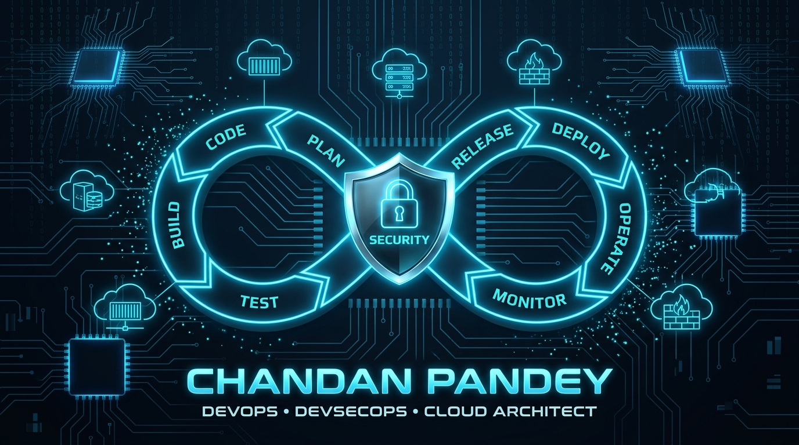
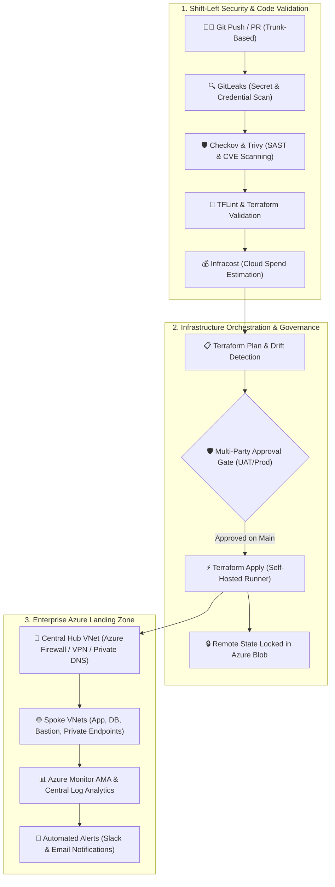

<div align="center">

  <!-- HERO BANNER (DEVOPS INFINITY LOOP LOGO) -->
  <a href="https://github.com/cpandey1993-ux">
    
  </a>

  <br/><br/>

  <h1>Hi, I'm Chandan Pandey 👋</h1>
  <h3>⚡ Senior Cloud, DevSecOps &amp; Infrastructure Architect</h3>

  <p align="center">
    <!-- Quick Contact Badges -->
    <a href="https://github.com/cpandey1993-ux"></a>
    <a href="https://www.linkedin.com/in/chandan-pandey-6b1601277"></a>
    
    
  </p>

  <!-- DYNAMIC TYPING SVG -->
  <a href="https://github.com/cpandey1993-ux">
    
  </a>

</div>

---

## 🚀 About Me

I'm a **DevSecOps Consultant & Cloud Architect** designing, securing, and automating enterprise cloud infrastructure on **Microsoft Azure**. I specialize in **Infrastructure as Code (Terraform)**, secure **CI/CD automation (Azure DevOps multi-stage YAML pipelines)**, and embedding security across the SDLC — turning manual, error-prone deployments into repeatable, auditable, self-service platforms.

- 🔭 **Specialization:** Enterprise Azure Landing Zones, DevSecOps automation, and zero-drift cloud environments
- 🛡️ **Security Focus:** Shift-left security, policy-as-code, and GitOps-driven delivery
- ☁️ **Cloud Depth:** Architecting secure Virtual Networks, Subnets, Bastion hosts, Storage Accounts, and Key Vault
- ⚙️ **IaC Mastery:** Reusable parent/child Terraform modules with remote state lease locking in Azure Blob storage
- 💬 **Ask me about:** Terraform, Azure DevOps YAML, Kubernetes, CI/CD security, and FinOps
- 📍 **Location:** Delhi, India

---

## 🏆 Key Enterprise Highlights (Architecture & Governance)

```
+--------------------------------------------------------------------------------------------------+
|                                    10 Scalability & Quality Pillars                               |
|                                                                                                  |
|  1. Scalable      2. Robust        3. Secure        4. Reliable       5. Portable                |
|  6. Governed      7. High Avail    8. Cost-Optim    9. Backed Up      10. Compliant & Monitored  |
+--------------------------------------------------------------------------------------------------+
```

- 🏛️ **Enterprise Governance & CAF:** Structured Tenant Root hierarchy separating Platform Management Groups (*Identity, Management, Connectivity*) from Workload Landing Zones (*Corp, Online, Dev, UAT, Prod Subscriptions*).
- ⚙️ **Terraform Modular Engineering:** Engineered decoupled, reusable child modules (`azurerm_resource_group`, `azurerm_vnet`, `azurerm_subnet`, `azurerm_storage_account`, `azurerm_keyvault`, `azurerm_vm`, `azurerm_bastion`) backed by Azure Blob remote state lease locking.
- 🔒 **Zero-Trust & Shift-Left DevSecOps:** Integrated automated security gates (**GitLeaks, Checkov, Trivy, TFLint, Infracost**) before deployment; enforced manual approval gates (`ManualValidation@1`) before production mutation.
- 🌐 **Enterprise Hub-and-Spoke Networking:** Centralized traffic inspection via Azure Firewall/NVAs with UDRs (`0.0.0.0/0`), Private Endpoints for PaaS, and private DNS resolution.
- 🔄 **100+ Workload Cloud Migration Strategy:** 5-phase migration framework (*Discovery, Assessment, Readiness, Cutover, Hypercare*) with minimal downtime windows.
- 💰 **FinOps & Cloud Economics:** Eliminating zombie resources (unattached disks, idle public IPs), 30-day rightsizing, and automated scheduling.

---

## 🏗️ End-to-End Enterprise DevSecOps Pipeline Architecture



---

## 🛠️ Tech Stack

### ☁️ Cloud Platforms & Networking
<p>
  
  
  
  
</p>

### 🏗️ Infrastructure as Code
<p>
  
  
  
  
</p>

### 🔄 CI/CD & DevSecOps Automation
<p>
  
  
  
  
</p>

### 🛡️ Cloud Security & Governance
<p>
  
  
  
  
  
</p>

### 🐳 Containers & Orchestration
<p>
  
  
  
</p>

### 📊 Monitoring, Cost & Observability
<p>
  
  
  
</p>

### 💻 Scripting & Systems
<p>
  
  
  
  
  
  
</p>

---

## 📂 Featured Repositories

| Repository | Focus Domain | Architecture & Technologies | Implementation Highlights |
| :--- | :--- | :--- | :--- |
| **[Chandan_terraform_module](https://github.com/cpandey1993-ux/Chandan_terraform_module)** | Infrastructure as Code | `Terraform` `HCL` `Azure RM` | Production-grade modular Azure architecture implementing reusable child modules (Resource Groups, Storage Accounts, Networking) with strict parameter hygiene and state isolation. |
| **[Birthday-notification](https://github.com/cpandey1993-ux/Birthday-notification)** | Event Automation & Scripting | `PowerShell` `Slack API` `SMTP` | Automated event monitoring and notification utility integrating secure secrets management, Slack Webhook payloads, and SMTP delivery. |
| **[Chandan-devOps-learning-journey](https://github.com/cpandey1993-ux/Chandan-devOps-learning-journey)** | DevSecOps Knowledge Base | `Linux` `Azure` `DevOps` `Git` | Deep technical repository documenting architectural blueprints, Linux administration, Azure resources, and CI/CD pipelines. |
| **[classic_pipeline_rg](https://github.com/cpandey1993-ux/classic_pipeline_rg)** | Release Engineering | `Azure DevOps` `Pipelines` `ARM` | Infrastructure provisioning and pipeline execution practices leveraging Azure DevOps automation workflows. |

---

## 📊 Live GitHub Engineering Metrics

<div align="center">

  <table border="0">
    <tr>
      <td width="50%" align="center">
        
      </td>
      <td width="50%" align="center">
        
      </td>
    </tr>
    <tr>
      <td colspan="2" align="center">
        
      </td>
    </tr>
  </table>

</div>

---

## 🤝 Let's Connect!

I'm always open to discussing **Cloud Architecture, DevSecOps transformations, Landing Zones, and enterprise consulting**:

<div align="center">

  <a href="https://www.linkedin.com/in/chandan-pandey-6b1601277">
    
  </a>
  &nbsp;
  <a href="https://github.com/cpandey1993-ux">
    
  </a>

  <br/><br/>
  <sub>📍 Based in <strong>Delhi, India</strong> • Open to Senior / Lead DevSecOps &amp; Cloud Platform Engagements</sub>

</div>
